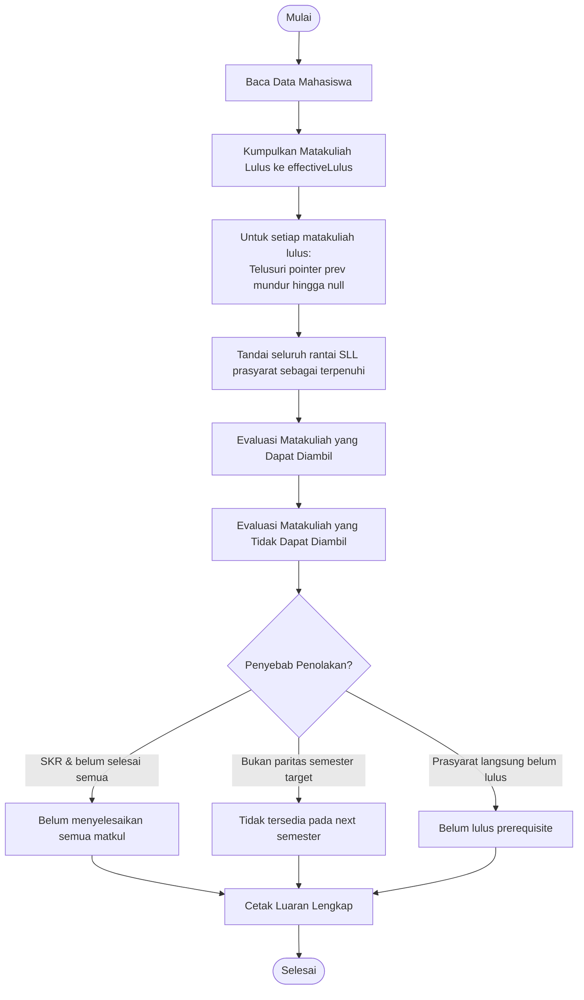

# Course Enrollment Availability Checker (Sistem Rekomendasi Rencana Studi)

Sistem penentu ketersediaan mata kuliah (*Course Enrollment Checker*) berbasis **Algoritma dan Struktur Data (ASD)**. Program ini menganalisis katalog mata kuliah kurikulum, ketergantungan prasyarat, serta rekam jejak akademik mahasiswa untuk menentukan mata kuliah apa saja yang memenuhi syarat (*eligible*) untuk diambil pada semester berikutnya, sekaligus merinci mata kuliah yang **tidak dapat diambil beserta alasan penolakannya**.

Proyek ini dibangun secara khusus dengan paradigma **murni array standar Java** (tanpa pustaka koleksi generik seperti `ArrayList`, `HashSet`, `HashMap`), menggunakan struktur data **Branched Singly Linked List (SLL)** di mana setiap node mata kuliah menyimpan pointer `prev` yang menunjuk mundur ke mata kuliah prasyaratnya.

---

## 📖 Gambaran Umum (Broad Overview)

Dalam sistem akademik perguruan tinggi, mahasiswa mengambil mata kuliah setiap semester dengan mematuhi dua aturan utama:
1. **Periodisitas Semester**: Mata kuliah tertentu hanya ditawarkan pada semester tertentu (Ganjil atau Genap), kecuali mata kuliah khusus (misalnya Skripsi) yang ditawarkan pada **Keduanya**.
2. **Ketergantungan Prasyarat (*Prerequisites*)**: Mata kuliah tingkat lanjut mensyaratkan kelulusan mata kuliah pendahulu (misal: *Pemrograman Lanjut* mensyaratkan *Pemrograman Dasar*).

### Masukan Program (*Inputs*)
Program membaca 3 berkas data yang berada dalam direktori yang sama:
- **`matakuliah.csv`**: Katalog seluruh mata kuliah dengan format:
  ```text
  Kode;Nama;sks;semester;ganjil/genap
  RPL;Rekayasa Perangkat Lunak;4;1;Ganjil
  PLAN;Pemrograman Lanjut;5;2;Genap
  SKR;Skripsi;6;8;Keduanya
  ```
- **`prasyarat.csv`**: Relasi ketergantungan prasyarat dengan format:
  ```text
  prasyarat;matakuliah
  PDAS;PLAN
  PLAN;ASD
  ASD;DAA
  ```
- **`mhs_01.txt`**: Data mahasiswa target dengan format:
  ```text
  semester_berikutnya=ganjil
  lulus=APS,DAA,JK,IMK,KA,KALJ
  ```

### Aturan Bisnis & Logika Akademik
1. **Filter Paritas Semester**: Hanya mata kuliah yang sesuai dengan `semester_berikutnya` (atau bertipe `Keduanya`) yang dipertimbangkan untuk dapat diambil.
2. **Eliminasi Mata Kuliah yang Sudah Lulus**: Mata kuliah yang sudah pernah diselesaikan tidak akan ditawarkan kembali.
3. **Penelusuran Rantai Prasyarat Mundur (*Backward Branched SLL Traversal*)**:
   - Jika mahasiswa telah lulus mata kuliah lanjutan (misalnya `DAA`), sistem mengasumsikan seluruh rantai prasyarat pendahulunya (`ASD` $\rightarrow$ `PLAN` $\rightarrow$ `PDAS`) **sudah pasti terpenuhi**.
   - Oleh karena itu, seluruh mata kuliah dalam rantai prasyarat tersebut otomatis di-*omit* (dieliminasi) agar tidak ditawarkan kembali.
4. **Verifikasi Prasyarat Langsung**: Mata kuliah baru hanya ditawarkan apabila prasyarat langsungnya (`node.prev`) sudah berstatus lulus atau terpenuhi dalam rantai prasyarat.
5. **Aturan Khusus Skripsi (`SKR`)**: Skripsi hanya dapat diambil jika mahasiswa telah menyelesaikan seluruh mata kuliah lain dalam kurikulum.
6. **Kategori Penolakan Mata Kuliah (*Unavailable Reasons*)**:
   - `"Tidak tersedia pada next semester"`: Mata kuliah tidak ditawarkan pada paritas semester berikutnya.
   - `"Belum lulus prerequisite"`: Mata kuliah ditawarkan pada semester berikutnya, namun prasyarat langsungnya belum lulus.
   - `"Belum menyelesaikan semua matkul"`: Khusus Skripsi (`SKR`), masih ada mata kuliah lain di kurikulum yang belum diselesaikan.

---

## 🛠️ Penjelasan Teknis (Technical Details)

Program diimplementasikan dalam satu berkas mandiri (`Main.java`) dengan struktur kelas:

```text
Main.java
├── public class Main
├── class Node
├── class UnavailableCourse
├── class CourseCatalog
├── class CsvLoader
├── class StudentData
├── class StudentFile
└── class EnrollmentChecker
```

### 1. Kepatuhan Bebas Koleksi Java (*No Java Collections / Generics*)
Untuk memenuhi kaidah murni Struktur Data:
- Tidak menggunakan `java.util.List`, `java.util.ArrayList`
- Tidak menggunakan `java.util.Set`, `java.util.HashSet`
- Tidak menggunakan `java.util.Map`, `java.util.HashMap`
- Tidak ada tipe parameter generik `<T>`
- Murni menggunakan **Array Primitif & Array Objek Standar**: `Node[]`, `UnavailableCourse[]`, `String[]`, `int[]`, serta pointer objek.

### 2. Representasi Struktur Data: Branched Singly Linked List (SLL)
Ketergantungan prasyarat antar mata kuliah dimodelkan sebagai **Branched Singly Linked List (Inverted Tree)**:
- **Node Singly Linked List (SLL)**:
  ```java
  class Node {
      String kode;
      String nama;
      int sks;
      int semester;
      Node prev;
  }
  ```
- **Karakteristik Branched SLL**:
  - Setiap node mata kuliah memiliki tepat satu pointer `prev` yang menunjuk mundur ke prasyaratnya (atau `null` jika tidak memiliki prasyarat).
  - Beberapa mata kuliah lanjutan dapat merujuk ke satu prasyarat yang sama (misalnya `JK` dan `IMK` keduanya menunjuk ke `SO`), membentuk percabangan struktur pohon terbalik (*branched list*).
  - Penelusuran rantai prasyarat cukup dilakukan mundur melalui pointer `prev` sampai bernilai `null`.

- **Pasangan Simpul & Alasan (*UnavailableCourse*)**:
  ```java
  class UnavailableCourse {
      Node node;
      String reason;
  }
  ```

- **Katalog Terpisah (Paritas Semester)**:
  - `Node[] odd`: Menampung mata kuliah semester ganjil.
  - `Node[] even`: Menampung mata kuliah semester genap.
  - `String[] kodes`: Menampung daftar seluruh kode unik mata kuliah kurikulum.
  - Mata kuliah `Keduanya` (misal `SKR`) diinstansiasi menjadi 2 node identik: satu masuk ke `odd`, satu masuk ke `even`.

### 3. Teknik *Two-Pass Scanning* (Alokasi Ukuran Eksak)
Untuk menghindari alokasi dinamis atau kapasitas yang ditebak, pembacaan file dilakukan dalam putaran terstruktur:
1. **Pass 1 (`matakuliah.csv`)**: Memindai file untuk menghitung jumlah total mata kuliah unik, jumlah ganjil, dan jumlah genap.
2. **Alokasi**: Mengalokasikan `Node[] odd`, `Node[] even`, dan `String[] kodes` dengan ukuran 100% presisi (*exact sizing*).
3. **Pass 2 (`matakuliah.csv`)**: Membaca ulang berkas untuk membuat objek `Node` dan mengisinya ke array `odd` dan `even`.
4. **Pass 3 (`prasyarat.csv`)**: Membaca file prasyarat satu kali putaran untuk menghubungkan pointer `mkNode.prev = prasyaratNode`.

### 4. Algoritma Pengecekan Ketersediaan (*Enrollment Checker*)



---

## 🚀 Panduan Kompilasi & Menjalankan

### Prasyarat
- Java Development Kit (JDK) versi 8 atau yang lebih baru.

### Langkah-langkah
Buka terminal / PowerShell dan arahkan ke direktori proyek:

```bash
cd D:\Sekul\ASD\FinalProjectASD
```

Kompilasi kode program:
```bash
javac Main.java
```

Jalankan program:
```bash
java Main
```

---

## 📊 Contoh Hasil Eksekusi

Dengan data mahasiswa pada [mhs_01.txt](file:///D:/Sekul/ASD/FinalProjectASD/mhs_01.txt):
```text
semester_berikutnya=ganjil
lulus=APS,DAA,JK,IMK,KA,KALJ
```

**Output Terminal:**
```text
Semester berikutnya: ganjil
Matakuliah yang dapat diambil (12):
 1. PKK    Pengenalan Keilmuan Komputer               2 sks  (smt 1)
 2. STP    Statistik dan Teori Peluang                2 sks  (smt 1)
 3. AGM    Agama                                      2 sks  (smt 1)
 4. MN     Metode Numerik                             3 sks  (smt 3)
 5. PAPB   Pengembangan Aplikasi Perangkat Bergerak   3 sks  (smt 5)
 6. JN     Jaringan Nirkabel                          3 sks  (smt 5)
 7. KG     Komputer Grafis                            2 sks  (smt 5)
 8. JST    Jaringan Saraf Tiruan                      3 sks  (smt 5)
 9. SI     Statistika Inferensi                       2 sks  (smt 5)
10. MPPI   Metodologi Penelitian dan Penulisan Ilmiah 3 sks  (smt 5)
11. BIND   Bahasa Indonesia                           2 sks  (smt 5)
12. PKL    Praktik Kerja Lapangan                     4 sks  (smt 7)
Total: 31 sks

Matakuliah yang tidak dapat diambil (11):
 1. BD     Basis Data                                 3 sks  (smt 2) - Tidak tersedia pada next semester
 2. MD     Matematika Diskret                         2 sks  (smt 2) - Tidak tersedia pada next semester
 3. EP     Etika Profesi                              2 sks  (smt 2) - Tidak tersedia pada next semester
 4. BING   Bahasa Inggris                             2 sks  (smt 2) - Tidak tersedia pada next semester
 5. PAW    Pengembangan Aplikasi Web                  3 sks  (smt 4) - Tidak tersedia pada next semester
 6. KI     Keamanan Informasi                         5 sks  (smt 4) - Tidak tersedia pada next semester
 7. PANC   Pancasila                                  2 sks  (smt 4) - Tidak tersedia pada next semester
 8. KWU    Kewirausahaan                              2 sks  (smt 4) - Tidak tersedia pada next semester
 9. KWN    Kewarganegaraan                            2 sks  (smt 4) - Tidak tersedia pada next semester
10. CAP    Capstone Project                           3 sks  (smt 6) - Tidak tersedia pada next semester
11. SKR    Skripsi                                    6 sks  (smt 8) - Belum menyelesaikan semua matkul
```
